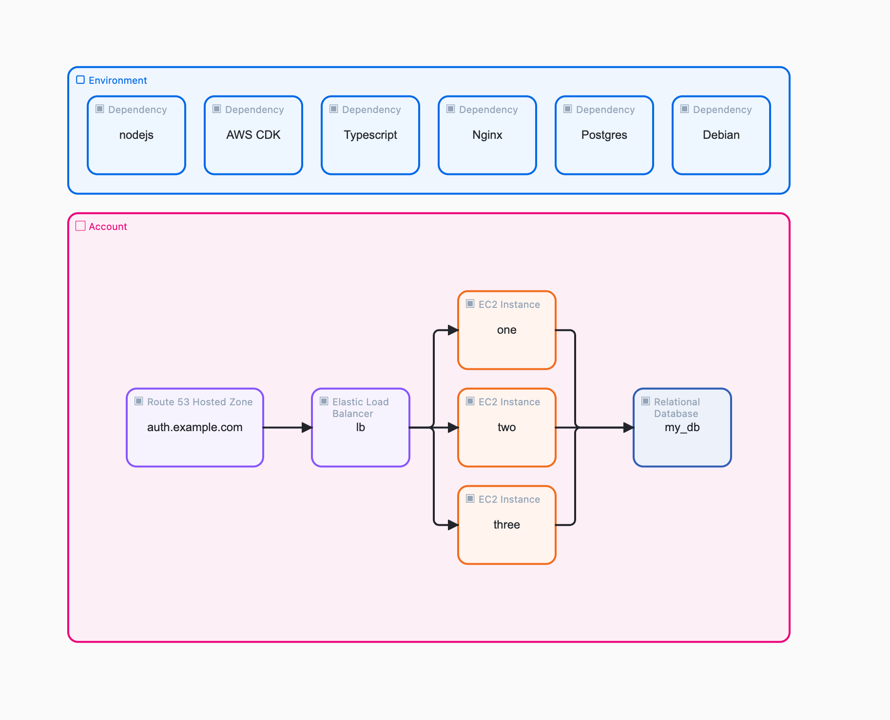

# lb-stack

AWS CDK (TypeScript) implementation of the DAI Studio diagram **"LB Stack"**
https://dai.studio/blog/ex_cloud_types_lb_stack_aws
v0.1.0
Build a load balanced service on AWS



## Prerequisites
- Node **26.10.0** (`.nvmrc`; `engines` enforces `>=26.10.0`, and npm only warns on older versions)
- AWS credentials for the target account. The region comes from `CDK_DEFAULT_REGION` / your profile.
- `npx cdk bootstrap`, run once per account/region
- Control over the parent domain (`example.com`) so you can delegate `auth`

## Commands
```sh
npm ci
npm run build     # tsc --noEmit (TypeScript 7)
npm test          # vitest + aws-cdk-lib/assertions
npx cdk synth
npx cdk diff
npx cdk deploy
```

## Configuration (CDK context)
Defaults are in `cdk.json`. Override them with `-c key=value`:

| Key | Default | Notes |
|---|---|---|
| `domainName` | `auth.example.com` | Zone name and site hostname |
| `instanceType` | `t4g.small` | Must be arm64 (Graviton) with the default AMI |
| `dbInstanceClass` | `t4g.micro` | Without the `db.` prefix. Used for the primary and the replica |
| `dbAllocatedStorage` | `20` | GB, gp3 |
| `instanceCount` | `3` | Instances beyond 3 are named `web-N` |
| `natGateways` | `1` | Use `2` for per-AZ egress resilience |
| `enableTls` | `true` | `false` creates an HTTP-only ALB with no ACM cert |

## Deploying
The stack creates the hosted zone itself. ACM validates the certificate through DNS records in that zone, so validation **can't finish until the parent domain delegates to the new zone**.

**Option A, single deploy:**
1. `npx cdk deploy`. The deploy pauses on `AWS::CertificateManager::Certificate`.
2. While it waits, get the name servers:
   `aws route53 get-hosted-zone --id <zone-id> --query DelegationSet.NameServers`
   (or check the Route 53 console). Then create an `NS` record for `auth` in the `example.com` zone with those values.
3. The deploy finishes once DNS propagates. CloudFormation fails the certificate if validation doesn't finish in time.

**Option B, two-phase, never blocks:**
1. `npx cdk deploy -c enableTls=false` (zone and HTTP-only ALB)
2. Delegate NS using the `NameServers` stack output.
3. `npx cdk deploy` (adds the cert, the HTTPS listener and the redirect)

Note: RDS creation plus the replica takes about 15–25 min. The instances wait for both, because their user data contains the endpoints.

## Verifying
```sh
curl -i https://auth.example.com/health        # 200 ok
for i in 1 2 3 4 5 6; do curl -s https://auth.example.com/ | grep -o 'Served by.*'; done   # one / two / three

aws ssm start-session --target <instance-id>    # from the InstanceIds output
# on the instance:
. /etc/dai/db.env
PGPASSWORD=$(aws secretsmanager get-secret-value --secret-id "$DB_SECRET_ARN" \
  --region "$AWS_REGION" --query SecretString --output text | python3 -c 'import json,sys;print(json.load(sys.stdin)["password"])')
export PGPASSWORD
psql "host=$DB_HOST dbname=$DB_NAME user=postgres sslmode=require" -c 'select version();'
psql "host=$DB_READ_HOST dbname=$DB_NAME user=postgres sslmode=require" -c 'select pg_is_in_recovery();'  # t
```
If targets show unhealthy, check `/var/log/cloud-init-output.log` over SSM.

## Cost (dev defaults, rough)
NAT gateway (hourly + data), ALB, 3 × `t4g.small`, 2 × `db.t4g.micro` plus storage, Route 53 zone, Secrets Manager secret. NAT and RDS cost the most. Run `cdk destroy` when you're not using the stack.

## Teardown
```sh
npx cdk destroy
```
- The RDS primary takes a **final snapshot**. Delete it manually if you don't need it.
- The **hosted zone is retained**, so the delegation stays valid. Delete its records and the zone manually, then remove the NS record from the parent zone.

## Layout
```
bin/app.ts                 CDK app (env from CDK_DEFAULT_*, tags)
lib/lb-stack.ts            the stack + context parsing
lib/user-data/nginx.sh     instance bootstrap
test/lb-stack.test.ts      assertions (uses cdk.json context)
```
